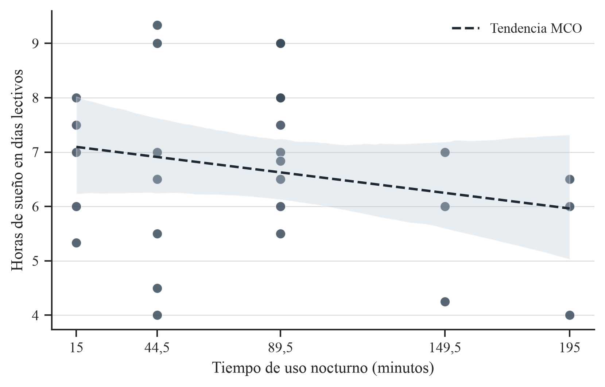
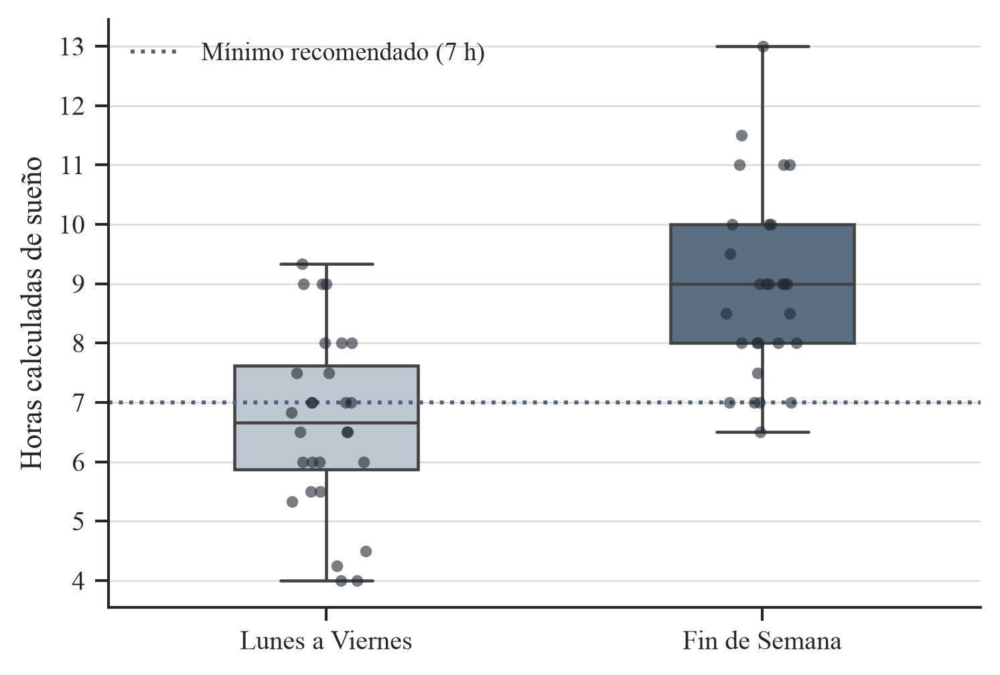

# Relación lineal entre el tiempo de uso nocturno de dispositivos electrónicos y la calidad del sueño (EECA-UCV, 2026-01S)

> **Linear relationship between nocturnal electronic device screen time and sleep quality among EECA-UCV students (2026-01S)**

[Español](#español) · [English](#english)

---

## Español

| Atributo | Detalle |
| :--- | :--- |
| **Institución** | Universidad Central de Venezuela (UCV) · Facultad de Ciencias Económicas y Sociales (FACES) · Escuela de Estadística y Ciencias Actuariales (EECA) |
| **Cátedra** | Departamento de Informática — Computación Estadística (`2026-01S`) |
| **Autores** | Armando Delfín, Giovanni Fermín, Anaís Moncada |
| **Profesora** | Oriana Medina |
| **Muestra analítica** | $n = 28$ estudiantes activos (Google Forms, 6 al 12 de noviembre de 2026) |

La exposición nocturna a pantallas comprime el descanso universitario mediante tres mecanismos descritos por LeBourgeois et al. (2017): desplazamiento horario del reposo, activación neurocognitiva prefrontal y supresión pineal de melatonina provocada por luz de onda corta ($450\text{--}480\text{ nm}$). Esa interferencia perturba el modelo regulador de dos procesos de Borbély (1982), donde el marcapasos circadiano (Proceso C) opera junto a la acumulación homeostática de adenosina, $S(t) = S_0 e^{-t/\tau}$ (Proceso S).

Este estudio cuantifica la asociación empírica entre la exposición previa al sueño ($\le 3\text{ h}$) y el descanso en estudiantes de pregrado de la EECA-UCV mediante un diseño observacional transversal. Los resultados muestran déficit horario entre semana, una compensación de fin de semana superior a dos horas y ausencia de pendiente lineal directa entre minutos de pantalla y duración nocturna.

### Medición cronológica y depuración de datos

El instrumento evita la aproximación retrospectiva calculando la duración del descanso de manera indirecta a partir de la hora habitual de acostarse ($t_{\text{acost}}$) y levantarse ($t_{\text{lev}}$), desagregada entre días lectivos (lunes a viernes) y fines de semana (sábados y domingos):

$$
t_{\text{sueño}} = \begin{cases} 24 - t_{\text{acost}} + t_{\text{lev}}, & \text{si } t_{\text{acost}} \ge 14 \\ t_{\text{lev}} - t_{\text{acost}}, & \text{si } t_{\text{acost}} < 14 \end{cases}, \qquad \Delta t = t_{\text{sueño, fin}} - t_{\text{sueño, sem}}
$$

La auditoría ejecutada en [generar_graficos.py](analisis_control_de_datos/generar_graficos.py) y documentada en [Diagnóstico de Calidad de Datos..pdf](analisis_control_de_datos/Diagn%C3%B3stico%20de%20Calidad%20de%20Datos..pdf) aplicó cuatro reglas sobre la matriz completa ($28 \times 12$, cero casillas vacías):

- **Corte temporal:** exclusión de la respuesta tardía #29 (15/11/2026, 13:38:32), recibida tras el cierre de recolección.
- **Ambigüedad 12 a.m./12 p.m.:** ajuste al formato de 24 horas en horarios de acostarse declarados cerca de la medianoche ($+12\text{ h}$ en el rango 08:00–11:59; $-12\text{ h}$ en 12:00–12:59), suprimiendo las horas brutas de reloj en las gráficas descriptivas.
- **Imputación por cota mínima:** asignación de la menor duración lectiva válida de la muestra ($4{,}00\text{ h}$) al registro #2, que reportó las 09:00 tanto al acostarse como al levantarse con $\ge 180\text{ min}$ en pantalla.
- **Codificación analítica:** extracción entera de respuestas abiertas de edad, asignación de marcas de clase continuas para minutos de pantalla ($15{,}0$; $44{,}5$; $89{,}5$; $149{,}5$; $195{,}0\text{ min}$) y recodificación ascendente de la sensación matutina ($1 =$ somnolencia persistente, $2 =$ cansancio leve, $3 =$ energía suficiente; cero casos en agotamiento severo).

### Hallazgos empíricos ($n = 28$)

El teléfono inteligente concentra el $67{,}86\,\%$ ($19/28$) del consumo digital previo a dormir, seguido por televisor o Smart TV ($14{,}29\,\%$), computadora de escritorio ($10{,}71\,\%$) y portátil ($7{,}14\,\%$). El $57{,}14\,\%$ de los estudiantes ($16/28$) supera los $60\text{ min}$ nocturnos frente a pantallas y el $21{,}43\,\%$ ($6/28$) excede las dos horas continuas.

En días lectivos, el $53{,}57\,\%$ ($15/28$) descansa menos del umbral mínimo de $7\text{ h}$ ($\bar{x} = 6{,}67\text{ h}$, $\tilde{x} = 6{,}67\text{ h}$, $s = 1{,}51\text{ h}$, $\text{IC}_{95\%} = [6{,}08;\,7{,}26]$). Los fines de semana la media asciende a $8{,}93\text{ h}$ ($\tilde{x} = 9{,}00\text{ h}$, $s = 1{,}58\text{ h}$, $\text{IC}_{95\%} = [8{,}32;\,9{,}54]$), arrojando un promedio ponderado semanal 5:2 de $7{,}32\text{ h}$ ($s = 1{,}18\text{ h}$) y una compensación individual $\overline{\Delta t} = +2{,}26\text{ h}$ ($s = 2{,}16\text{ h}$, $\text{IC}_{95\%} = [1{,}42;\,3{,}10]$).

| Contraste / indicador | Hipótesis alternativa o variables | Estadístico | $gl$ | $p$ | Decisión ($\alpha = 0{,}05$) |
| :--- | :--- | :--- | :---: | :---: | :--- |
| 1. Déficit lectivo ($t$ de una muestra) | $H_1: \mu_{\text{sem}} < 7$ | $t = -1{,}1559$ | $27$ | $0{,}1289$ | No se rechaza $H_0$ |
| 2. *Jetlag* social ($t$ pareada / Wilcoxon) | $H_1: \mu_{\Delta t} > 0$ | $t = 5{,}5401$ ($W = 13{,}0$) | $27$ | $3{,}58 \times 10^{-6}$ ($1{,}13 \times 10^{-5}$) | Se rechaza $H_0$ |
| 3. Regresión MCO (`Sueno_Semana ~ Minutos`) | $H_1: \beta_1 \neq 0$ ($\hat{\beta}_1 = -0{,}0063$, $R^2 = 0{,}0543$) | $F = 1{,}4936$ | $(1,\,26)$ | $0{,}2326$ | No se rechaza $H_0$ |
| Independencia tramo $\times$ sensación ($3 \times 3$) | Tramo pantalla $\times$ sensación al despertar | $\chi^2 = 5{,}7100$ | $4$ | $0{,}2219$ | No se rechaza $H_0$ ($77{,}8\,\%$ esp. $< 5$) |
| 4a. Correlación de Pearson | Minutos de pantalla vs. horas lectivas | $r = -0{,}2331$ | $26$ | $0{,}2326$ | No se rechaza $H_0$ |
| 4b. Correlación de Spearman | Minutos de pantalla vs. calidad matutina (1–3) | $r_s = +0{,}4064$ | $26$ | $0{,}0318$ | Se rechaza $H_0$ |
| 4c. Correlación de Spearman | Minutos de pantalla vs. despertares (0–3) | $r_s = -0{,}0011$ | $26$ | $0{,}9957$ | No se rechaza $H_0$ |

La prueba de Shapiro-Wilk verifica normalidad en el sueño lectivo ($W = 0{,}9623$, $p = 0{,}3954$), en fines de semana ($W = 0{,}9483$, $p = 0{,}1797$) y en los residuos de la regresión MCO ($W = 0{,}9709$, $p = 0{,}6049$; Durbin–Watson $= 2{,}074$; Jarque–Bera $= 0{,}632$, $p = 0{,}729$). La diferencia pareada $\Delta t$ rechaza normalidad ($W = 0{,}9248$, $p = 0{,}0456$), motivando la verificación no paramétrica mediante rangos con signo de Wilcoxon.

La hora de despertar en días de clase opera como restricción exógena fijada por el horario académico y amortigua el efecto lineal de la exposición en cama sobre la duración total ($\hat{\beta}_1 = -0{,}0063\text{ h/min}$, $p = 0{,}2326$). La correlación positiva de Spearman ($r_s = +0{,}4064$) refleja un puntaje matutino medio creciente en esta muestra ($1{,}58$ en $< 60\text{ min}$; $1{,}90$ en $60\text{--}119\text{ min}$; $2{,}00$ en $\ge 120\text{ min}$), distorsionado por variables de confusión no observadas y por una potencia estadística $1 - \beta$ acotada a $n = 28$.

| Regresión MCO: minutos de pantalla vs. sueño lectivo | Asimetría semanal: lunes a viernes vs. fin de semana |
| :---: | :---: |
|  |  |

### Estructura del repositorio

```text
.
├── anteproyecto/
│   ├── anteproyecto.tex
│   ├── anteproyecto.pdf
│   └── Anteproyecto_Calidad_de_sueño.ipynb
├── cuestionario/
│   ├── Cuestionario Definitivo - Uso de Dispositivos Electrónicos y Calidad del Sueño.tex
│   └── Cuestionario Definitivo - Uso de Dispositivos Electrónicos y Calidad del Sueño.pdf
├── analisis_control_de_datos/
│   ├── Encuesta sobre uso de dispositivos y calidad del sueño (Respuestas).xlsx
│   ├── Análisis_y_Control_de_datos.ipynb
│   ├── Diagnóstico de Calidad de Datos..pdf
│   ├── generar_graficos.py
│   ├── cuadros_resultados.md
│   └── resultados_inferencia.json
├── Informe_Final/
│   ├── Informe_Final_Calidad_de_Sueño.ipynb
│   └── Entregables/
│       ├── Informe_Final_Calidad_de_Sueño.tex
│       ├── Informe_Final_Calidad_de_Sueño.pdf
│       ├── cuadros_resultados.tex
│       └── grafico_*.png (14 gráficos descriptivos y analíticos a 300 dpi)
└── Relación Lineal_ Uso Nocturno de Pantallas y Calidad del Sueño (EECA-UCV).pptx
```

### Reproducibilidad

1. **Procesamiento estadístico, tablas y gráficos (Python $\ge 3{,}12$ con `uv`):** el script [generar_graficos.py](analisis_control_de_datos/generar_graficos.py) declara sus dependencias en cabecera PEP 723 (`pandas`, `numpy`, `matplotlib`, `seaborn`, `scipy`, `statsmodels`, `openpyxl`) y genera los 14 gráficos PNG, `cuadros_resultados.tex`, `cuadros_resultados.md` y `resultados_inferencia.json`:

```bash
cd analisis_control_de_datos
uv run generar_graficos.py
```

2. **Compilación del informe definitivo (LaTeX):** requiere dos pasadas de `pdflatex` para resolver tabla de contenido, índices de cuadros/gráficos y referencias cruzadas:

```bash
cd Informe_Final/Entregables
pdflatex Informe_Final_Calidad_de_Sueño.tex
pdflatex Informe_Final_Calidad_de_Sueño.tex
```

### Limitaciones metodológicas

- **Sesgo de autorreporte:** la estimación de horarios y despertares depende de la memoria del encuestado, sin registro actigráfico objetivo entre tiempo en cama y latencia de conciliación.
- **Muestreo no probabilístico y tamaño muestral:** la difusión por mensajería estudiantil limita la generalización poblacional y reduce la potencia $1 - \beta$ para detectar efectos marginales pequeños con $n = 28$.
- **Factores exógenos no controlados:** consumo de cafeína, traslados urbanos, jornada laboral y horarios académicos tempranos confunden la relación directa entre pantalla y recuperación matutina.
- **Selector horario y ajustes instrumentales:** la ambigüedad 12 a.m./12 p.m. en Google Forms obligó a estandarizar horarios al acostarse; respecto al anteproyecto, el instrumento definitivo omitió carrera y latencia pre-sueño y redujo la escala de sensación matutina de cinco a cuatro categorías.

---

## English

| Field | Detail |
| :--- | :--- |
| **Institution** | Universidad Central de Venezuela (UCV) · Faculty of Economic and Social Sciences (FACES) · School of Statistics and Actuarial Sciences (EECA) |
| **Course** | Department of Informatics — Statistical Computing (`2026-01S`) |
| **Authors** | Armando Delfín, Giovanni Fermín, Anaís Moncada |
| **Instructor** | Oriana Medina |
| **Analytical Sample** | $n = 28$ active undergraduate students (Google Forms, November 6–12, 2026) |

Nocturnal screen exposure compresses university sleep through three physiological pathways described by LeBourgeois et al. (2017): bedtime displacement, prefrontal neurocognitive arousal, and pineal melatonin suppression driven by short-wavelength blue light ($450\text{--}480\text{ nm}$). That interference disrupts Borbély's (1982) two-process sleep model, in which circadian oscillation (Process C) interacts with homeostatic adenosine pressure, $S(t) = S_0 e^{-t/\tau}$ (Process S).

This observational cross-sectional study quantifies the association between pre-sleep screen exposure ($\le 3\text{ h}$) and sleep duration and perceived morning recovery among EECA-UCV undergraduates. Empirical estimates establish weekday sleep restriction alongside weekend catch-up exceeding two hours, while simple linear regression detects no direct slope between screen minutes and weekday sleep hours.

### Chronological Measurement and Data Cleaning

To avoid retrospective duration recall error, sleep length is derived indirectly from reported bedtime ($t_{\text{bed}}$) and wake time ($t_{\text{wake}}$) separately for weekdays (Mon–Fri) and weekends (Sat–Sun):

$$
t_{\text{sleep}} = \begin{cases} 24 - t_{\text{bed}} + t_{\text{wake}}, & \text{if } t_{\text{bed}} \ge 14 \\ t_{\text{wake}} - t_{\text{bed}}, & \text{if } t_{\text{bed}} < 14 \end{cases}, \qquad \Delta t = t_{\text{sleep, wkend}} - t_{\text{sleep, wkday}}
$$

The data audit implemented in [generar_graficos.py](analisis_control_de_datos/generar_graficos.py) and detailed in [Diagnóstico de Calidad de Datos..pdf](analisis_control_de_datos/Diagn%C3%B3stico%20de%20Calidad%20de%20Datos..pdf) applied four cleaning rules to the $28 \times 12$ zero-missing matrix:

- **Cutoff enforcement:** exclusion of late submission #29 (Nov 15, 2026, 13:38:32), logged after the collection window closed.
- **12 a.m./12 p.m. disambiguation:** 24-hour normalization for bedtimes entered near midnight under Google Forms time-picker ambiguity ($+12\text{ h}$ for 08:00–11:59; $-12\text{ h}$ for 12:00–12:59), omitting raw clock readings from descriptive plots.
- **Minimum lower-bound imputation:** assignment of the lowest valid sample weekday duration ($4.00\text{ h}$) to case #2, which recorded 09:00 for both bedtime and wake time alongside $\ge 180\text{ min}$ screen use.
- **Variable encoding:** integer parsing of free-text age entries, continuous midpoint mapping for screen-time brackets ($15.0$, $44.5$, $89.5$, $149.5$, $195.0\text{ min}$), and ascending ordinal encoding of morning recovery ($1 =$ persistent drowsiness, $2 =$ mild fatigue, $3 =$ sufficient energy; zero severe-exhaustion responses).

### Empirical Findings ($n = 28$)

Smartphones account for $67.86\%$ ($19/28$) of pre-sleep device use, followed by TVs/Smart TVs ($14.29\%$), desktops ($10.71\%$), and laptops ($7.14\%$). Over half the sample ($57.14\%$, $16/28$) exceeds $60\text{ min}$ of pre-sleep screen time, and $21.43\%$ ($6/28$) exceeds two hours.

On weekdays, $53.57\%$ ($15/28$) sleep below the $7\text{ h}$ healthy minimum ($\bar{x} = 6.67\text{ h}$, $\tilde{x} = 6.67\text{ h}$, $s = 1.51\text{ h}$, $95\%\text{ CI } [6.08,\,7.26]$). Weekend duration rises to $\bar{x} = 8.93\text{ h}$ ($\tilde{x} = 9.00\text{ h}$, $s = 1.58\text{ h}$, $95\%\text{ CI } [8.32,\,9.54]$), yielding a 5:2 weighted weekly mean of $7.32\text{ h}$ ($s = 1.18\text{ h}$) and an individual social jetlag gap of $\overline{\Delta t} = +2.26\text{ h}$ ($s = 2.16\text{ h}$, $95\%\text{ CI } [1.42,\,3.10]$).

| Test / Metric | Alternative Hypothesis or Variables | Statistic | $df$ | $p$ | Decision ($\alpha = 0.05$) |
| :--- | :--- | :--- | :---: | :---: | :--- |
| 1. Weekday deficit (one-sample $t$) | $H_1: \mu_{\text{wkday}} < 7$ | $t = -1.1559$ | $27$ | $0.1289$ | Fail to reject $H_0$ |
| 2. Social jetlag (paired $t$ / Wilcoxon) | $H_1: \mu_{\Delta t} > 0$ | $t = 5.5401$ ($W = 13.0$) | $27$ | $3.58 \times 10^{-6}$ ($1.13 \times 10^{-5}$) | Reject $H_0$ |
| 3. Simple OLS (`Sueno_Semana ~ Minutos`) | $H_1: \beta_1 \neq 0$ ($\hat{\beta}_1 = -0.0063$, $R^2 = 0.0543$) | $F = 1.4936$ | $(1,\,26)$ | $0.2326$ | Fail to reject $H_0$ |
| Screen bracket $\times$ recovery ($3 \times 3$) | Screen bracket $\times$ morning feeling | $\chi^2 = 5.7100$ | $4$ | $0.2219$ | Fail to reject $H_0$ ($77.8\%$ exp. $< 5$) |
| 4a. Pearson correlation | Screen minutes vs. weekday sleep | $r = -0.2331$ | $26$ | $0.2326$ | Fail to reject $H_0$ |
| 4b. Spearman correlation | Screen minutes vs. morning quality (1–3) | $r_s = +0.4064$ | $26$ | $0.0318$ | Reject $H_0$ |
| 4c. Spearman correlation | Screen minutes vs. awakenings (0–3) | $r_s = -0.0011$ | $26$ | $0.9957$ | Fail to reject $H_0$ |

Shapiro-Wilk tests support normality for weekday sleep ($W = 0.9623$, $p = 0.3954$), weekend sleep ($W = 0.9483$, $p = 0.1797$), and OLS residuals ($W = 0.9709$, $p = 0.6049$; Durbin–Watson $= 2.074$; Jarque–Bera $= 0.632$, $p = 0.729$). Paired differences $\Delta t$ depart from normality ($W = 0.9248$, $p = 0.0456$), requiring confirmation via the non-parametric Wilcoxon signed-rank test.

Fixed morning class schedules act as an exogenous constraint on wake times, absorbing potential linear reductions in sleep duration across screen-time levels ($\hat{\beta}_1 = -0.0063\text{ h/min}$, $p = 0.2326$). The positive Spearman association ($r_s = +0.4064$) reflects higher mean recovery scores in longer exposure brackets within this sample ($1.58$ for $<60\text{ min}$; $1.90$ for $60\text{--}119\text{ min}$; $2.00$ for $\ge 120\text{ min}$), driven by unmeasured confounding (academic workload, stimulants) under limited statistical power ($1 - \beta$) at $n = 28$.

| OLS regression: screen minutes vs. weekday sleep | Weekly asymmetry: weekdays vs. weekends |
| :---: | :---: |
|  |  |

### Repository Structure

```text
.
├── anteproyecto/
│   ├── anteproyecto.tex
│   ├── anteproyecto.pdf
│   └── Anteproyecto_Calidad_de_sueño.ipynb
├── cuestionario/
│   ├── Cuestionario Definitivo - Uso de Dispositivos Electrónicos y Calidad del Sueño.tex
│   └── Cuestionario Definitivo - Uso de Dispositivos Electrónicos y Calidad del Sueño.pdf
├── analisis_control_de_datos/
│   ├── Encuesta sobre uso de dispositivos y calidad del sueño (Respuestas).xlsx
│   ├── Análisis_y_Control_de_datos.ipynb
│   ├── Diagnóstico de Calidad de Datos..pdf
│   ├── generar_graficos.py
│   ├── cuadros_resultados.md
│   └── resultados_inferencia.json
├── Informe_Final/
│   ├── Informe_Final_Calidad_de_Sueño.ipynb
│   └── Entregables/
│       ├── Informe_Final_Calidad_de_Sueño.tex
│       ├── Informe_Final_Calidad_de_Sueño.pdf
│       ├── cuadros_resultados.tex
│       └── grafico_*.png (14 descriptive and analytical charts at 300 dpi)
└── Relación Lineal_ Uso Nocturno de Pantallas y Calidad del Sueño (EECA-UCV).pptx
```

### Reproducibility

1. **Statistical pipeline, tables, and charts (Python $\ge 3.12$ via `uv`):** [generar_graficos.py](analisis_control_de_datos/generar_graficos.py) embeds PEP 723 dependencies (`pandas`, `numpy`, `matplotlib`, `seaborn`, `scipy`, `statsmodels`, `openpyxl`) and outputs all 14 PNG charts, `cuadros_resultados.tex`, `cuadros_resultados.md`, and `resultados_inferencia.json`:

```bash
cd analisis_control_de_datos
uv run generar_graficos.py
```

2. **Final report compilation (LaTeX):** run `pdflatex` twice to resolve the table of contents, table/figure indices, and cross-references:

```bash
cd Informe_Final/Entregables
pdflatex Informe_Final_Calidad_de_Sueño.tex
pdflatex Informe_Final_Calidad_de_Sueño.tex
```

### Methodological Limitations

- **Self-report recall bias:** reported bed/wake times and awakenings rely on participant memory without actigraphy, conflating time in bed with sleep-onset latency.
- **Non-probabilistic sample and low power:** convenience distribution via student messaging restricts population inference and limits statistical power ($1 - \beta$) to detect small marginal slopes at $n = 28$.
- **Uncontrolled exogenous confounders:** caffeine intake, urban transit times, employment hours, and early-morning classes confound direct effects on sleep duration and morning alertness.
- **Time-picker ambiguity and instrument adjustments:** Google Forms 12h/24h bedtime ambiguity required post-hoc standardization; relative to the proposal, the final questionnaire omitted degree program and sleep-onset latency and used four morning-recovery categories instead of five.
